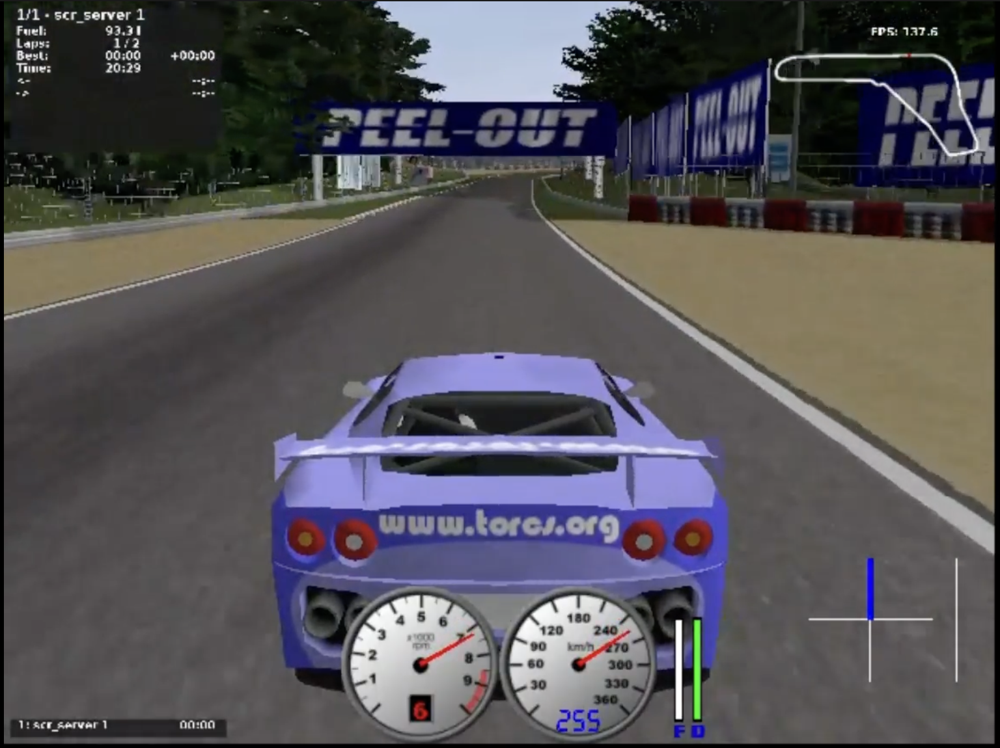
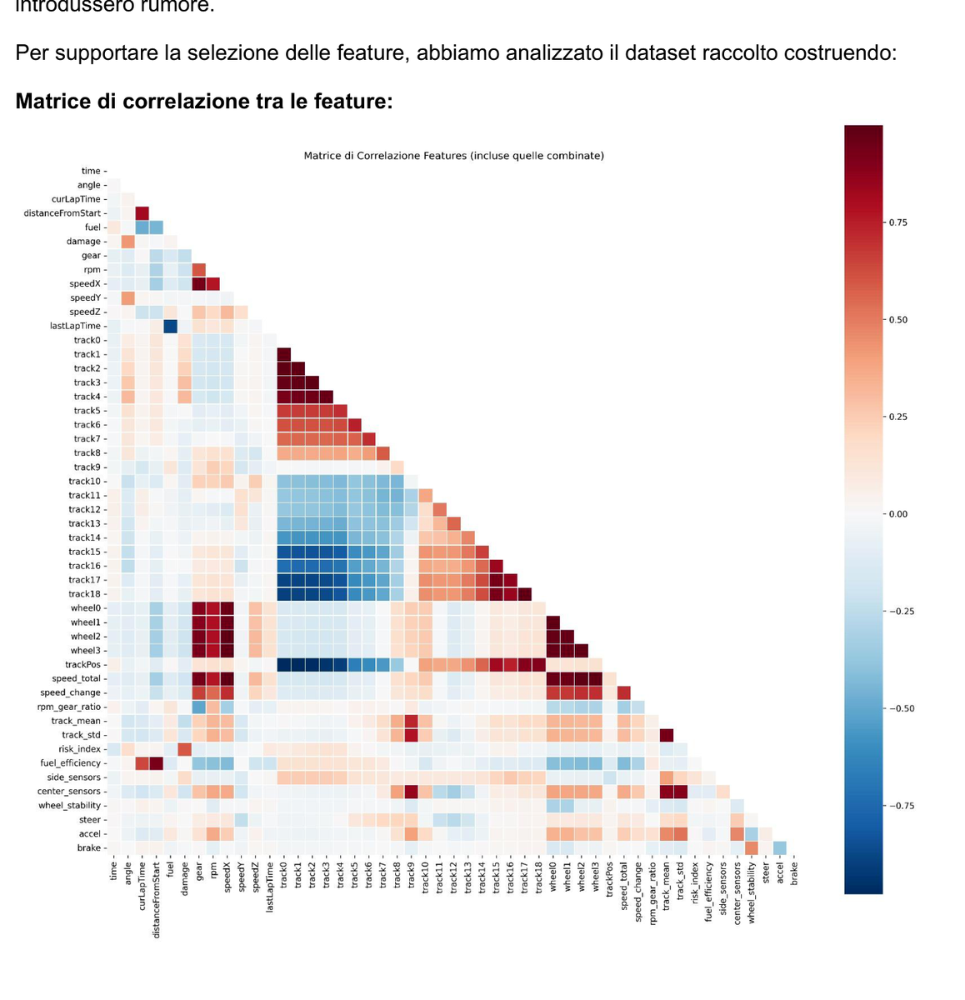
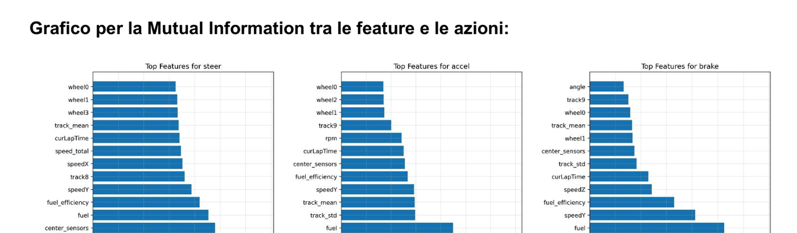
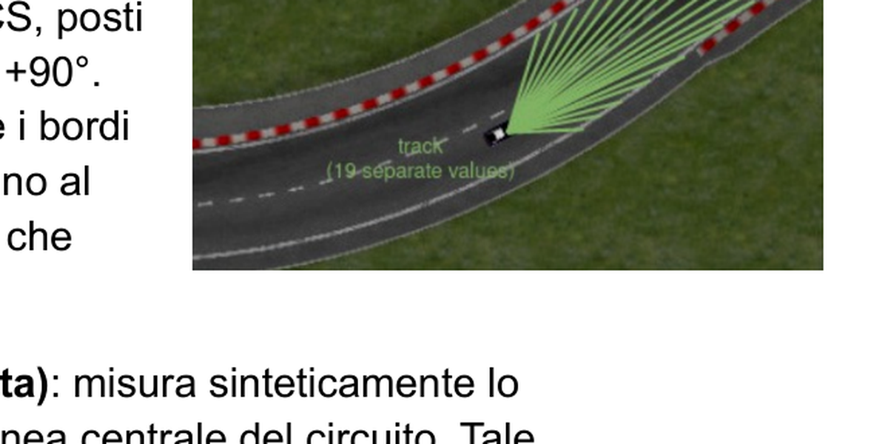

# Autonomous Driving in TORCS — Behavioral Cloning with K-NN (KD-Tree)

Autonomous driver for **TORCS** built with **Behavioral Cloning + K-Nearest Neighbors**, accelerated via **KD-Tree** search and designed for robustness (fallback + stuck detection + OOD guards).

**Repo:** https://github.com/landigf/TORCS

> ⚠️ Portfolio/educational project. No credentials or proprietary datasets are committed.

---

## Demo

### Cinematic run


### Technical view (telemetry)


---

## Feature selection (data-driven)

We selected a compact, low-redundancy feature set using:
- **Correlation matrix** (to reduce redundant inputs)
- **Mutual information** (to keep the most informative features for control)





Track sensors used (subset of the 19 front sensors):


---

## Core idea

1. **Collect** a dataset from manual driving (TORCS sensors + human actions).
2. **Normalize** features so Euclidean distance is meaningful and stable.
3. **Build** a **KD-Tree** model and serialize it to a `.tree` file.
4. **Drive** autonomously by retrieving nearest expert actions in real time, with safety fallback logic.

---

## Key features

- **Behavioral Cloning with K-NN:** imitation learning via nearest-neighbor matching (state → action).
- **KD-Tree search + serialization:** faster than linear scan; models saved as `.tree`.
- **Track segmentation:** multiple KD-Trees by `distanceFromStart` for higher local coherence and lower latency.
- **Weighted distance + dynamic k:** stability/precision tradeoff depending on driving context.
- **Robustness mechanisms:** action caching, out-of-distribution (OOD) thresholding, latency guard, off-track recovery, and stuck detection with rule-based fallback.

---

## Quickstart (4 steps)

> TORCS SCR server typically listens on `localhost:3001`. Adjust host/port if needed.

### Step 1 — Collect the dataset (manual driving logs)

```bash
javac -d classes src/scr/*.java src/scr/ai/SimpleGear.java src/scr/ai/DataLoggerDriver.java
cd classes
java -cp . scr.Client scr.ai.DataLoggerDriver localhost:3001 verbose:on
```

Remote example:

```bash
java -cp . scr.Client scr.ai.DataLoggerDriver host:172.19.196.17 port:3001 verbose:on
```

### (Optional) Step 1.a — Clean/validate dataset

```bash
python .utility/dataset_clean.py
```

---

### Step 2 — Build the KD-Tree model (`.tree`)

```bash
javac -d classes src/scr/ai/DataPoint.java src/scr/ai/KDTree.java src/scr/ai/DatasetBuilder.java
cd classes
java -cp . scr.ai.DatasetBuilder ../classes/dataset_union.csv knn.tree
```

---

### Step 3 — Compile the K-NN driver

```bash
javac -d classes -cp classes src/scr/ai/ActionCache.java src/scr/ai/KNNDriver.java
```

---

### Step 4 — Run autonomous driving

```bash
cd classes
java -cp . scr.Client scr.ai.KNNDriver localhost:3001 verbose:on
```

---

## Build script (PowerShell)

```powershell
.\.build_knn.ps1
.\.build_knn.ps1 -Config sensors
.\.build_knn.ps1 -Config all
.\.build_knn.ps1 -Config sensors -DatasetPath "my_dataset.csv" -ModelName "my_model.tree"
```

---

## Repository structure (as-is)

- `src/` — Java sources (drivers, KDTree, dataset builder, etc.)
- `.utility/` — Python utilities (dataset cleaning, analysis)
- `classes/` — compiled output (generated by build steps)
- `.build_knn.ps1` — build helper script

---

## Authors

- Gennaro Francesco Landi
- Maurizio Melillo
- Elettra Palmisano
